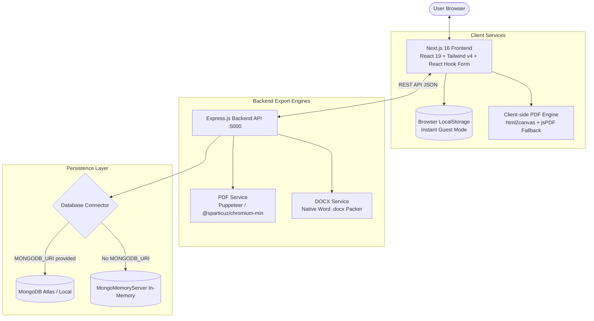

# 📄 ResumeBuilder — Full-Stack Real-Time Resume Builder & Document Export Platform

[](https://nextjs.org/)
[](https://react.dev/)
[](https://www.typescriptlang.org/)
[](https://tailwindcss.com/)
[](https://expressjs.com/)
[](https://pptr.dev/)
[](https://www.mongodb.com/)
[](LICENSE)

**ResumeBuilder** is a modern, full-stack web application designed to help job seekers, developers, and professionals build ATS-friendly, publication-grade resumes in real time. Featuring live side-by-side editing, 3 designer templates (*Modern*, *Minimalist*, *Creative*), high-fidelity **server-side PDF generation** with headless Puppeteer, client-side offline fallback, and native **Microsoft Word (.docx)** export.

---

## 🌟 Key Features

### 1. ⚡ Live Interactive Resume Editor
* **Real-Time WYSIWYG Preview**: Instant side-by-side updates as you type your personal info, experience, education, skills, and projects.
* **Auto-Save Resilience**: Automatic debounced saving ensures you never lose resume edits.
* **A4 Standard Aspect Ratio**: 1:1 scaled 210mm × 297mm canvas preview matching exact print and export geometry.

### 2. 🎨 3 Professional Designer Templates
* **Modern**: High-impact blue accents, structured card sections, and clean typography ideal for tech and corporate roles.
* **Minimalist**: High-contrast monochrome aesthetic with clean dividers and timeless serif/sans-serif hierarchy.
* **Creative**: Contemporary two-column layout with vibrant purple highlights, project showcase badges, and skill chips.

### 3. 📄 Dual Export Pipeline (PDF & DOCX)
* **Headless Puppeteer Server-Side PDF**: Generates sharp, vector-quality PDF documents with precision margins via `/api/resumes/export/pdf`.
* **Zero-Failure Client Fallback**: If the server is offline or under heavy load, the app automatically fails over to client-side `html2canvas` + `jsPDF` rendering directly in the browser!
* **Native Microsoft Word (.docx) Export**: Converts JSON resume schema into fully editable, styled Word documents via `/api/resumes/export/docx` using the `docx` library.

### 4. 🚀 Zero-Barrier Guest Mode + User Accounts
* **Instant Guest Mode**: Start building resumes immediately with zero login or signup barrier. State is persisted in browser `localStorage`.
* **Optional Authentication**: Full JWT token-based auth (`/api/auth/signup`, `/api/auth/login`) with bcrypt password hashing for multi-device cloud syncing.

### 5. 🗄️ In-Memory MongoDB Fallback
* Works out-of-the-box for local development using `mongodb-memory-server`. If `MONGODB_URI` is omitted, an in-memory database instance automatically starts without requiring external installations or Docker.

---

## 🏛️ System Architecture



---

## 📂 Project Structure

```
resume_builder/
├── backend/                        # Express.js REST API
│   ├── src/
│   │   ├── index.js                # App entry point, middleware & route mounting
│   │   ├── config/
│   │   │   └── db.js               # MongoDB connection with MongoMemoryServer fallback
│   │   ├── controllers/
│   │   │   ├── authController.js   # User registration, login, and profile
│   │   │   └── resumeController.js # CRUD handlers for saved resumes
│   │   ├── middleware/
│   │   │   └── auth.js             # JWT verification middleware
│   │   ├── models/
│   │   │   ├── User.js             # User Mongoose schema
│   │   │   └── Resume.js           # Resume document schema
│   │   ├── routes/
│   │   │   ├── auth.js             # /api/auth routes
│   │   │   └── resume.js           # /api/resumes & /export endpoints
│   │   └── services/
│   │       ├── pdfService.js       # Puppeteer headless HTML-to-PDF engine
│   │       └── docxService.js      # docx document builder & packer
│   ├── package.json                # Backend dependencies and scripts
│   ├── vercel.json                 # Vercel serverless deployment config
│   ├── render.yaml                 # Render web service config
│   └── .env.example                # Backend environment template
├── frontend/                       # Next.js 16 App Router UI
│   ├── src/
│   │   ├── app/
│   │   │   ├── page.tsx            # Landing page & feature showcases
│   │   │   ├── layout.tsx          # Root layout & Navbar integration
│   │   │   ├── globals.css         # Tailwind v4 directives & theme styles
│   │   │   ├── builder/page.tsx    # Live side-by-side resume editor
│   │   │   ├── dashboard/page.tsx  # User resume management grid
│   │   │   └── auth/               # Login & Signup pages
│   │   ├── components/
│   │   │   ├── layout/Navbar.tsx   # Global navigation bar
│   │   │   └── templates/          # Resume rendering templates
│   │   │       ├── ModernTemplate.tsx
│   │   │       ├── MinimalistTemplate.tsx
│   │   │       ├── CreativeTemplate.tsx
│   │   │       └── ResumePreview.tsx
│   │   ├── context/AuthContext.tsx # User session context
│   │   └── lib/api.ts              # Axios HTTP client
│   ├── package.json                # Frontend dependencies and scripts
│   ├── tsconfig.json               # TypeScript configuration
│   ├── vercel.json                 # Vercel frontend config
│   └── .env.example                # Frontend environment template
├── render.yaml                     # Root Render deployment blueprint
├── LICENSE                         # MIT License
└── README.md                       # Repository documentation
```

---

## 🚀 Quickstart Guide

### Prerequisites
* **Node.js**: v18.0.0 or higher (v20+ recommended)
* **npm** or **pnpm**
* **Git**

---

### Step 1: Clone the Repository
```bash
git clone https://github.com/rangithkumarpathyam-collab/resume_builder.git
cd resume_builder
```

---

### Step 2: Setup the Backend

1. **Navigate to the `backend` folder:**
   ```bash
   cd backend
   ```

2. **Install dependencies:**
   ```bash
   npm install
   ```

3. **Configure environment variables:**
   ```bash
   # Windows PowerShell
   Copy-Item .env.example .env

   # Linux / macOS
   cp .env.example .env
   ```
   *(Note: Leaving `MONGODB_URI` blank uses the built-in in-memory MongoDB instance automatically).*

4. **Start the backend server:**
   ```bash
   npm run dev
   ```
   The backend API will start on **`http://localhost:5000`**.
   *Verify health at: `http://localhost:5000/api/health`.*

---

### Step 3: Setup the Frontend

In a new terminal window:

1. **Navigate to the `frontend` folder:**
   ```bash
   cd frontend
   ```

2. **Install dependencies:**
   ```bash
   npm install
   ```

3. **Configure environment variables:**
   ```bash
   # Windows PowerShell
   Copy-Item .env.example .env.local

   # Linux / macOS
   cp .env.example .env.local
   ```

4. **Start the Next.js development server:**
   ```bash
   npm run dev
   ```

5. **Open the Application:**
   Visit **`http://localhost:3000`** in your browser.
   Click **"Start Building"** or go directly to `http://localhost:3000/builder` to create your resume!

---

## ⚙️ Environment Variables Reference

### Backend (`backend/.env`)

| Variable | Description | Default |
| :--- | :--- | :--- |
| `PORT` | Express server port | `5000` |
| `NODE_ENV` | Application environment (`development` / `production`) | `development` |
| `MONGODB_URI` | MongoDB connection string (falls back to memory server if omitted) | `""` |
| `JWT_SECRET` | Secret key for signing JSON Web Tokens | `supersecret_jwt_key` |

### Frontend (`frontend/.env.local`)

| Variable | Description | Default |
| :--- | :--- | :--- |
| `NEXT_PUBLIC_API_URL` | Base endpoint for the backend API | `http://localhost:5000/api` |

---

## 📡 REST API Reference

### 1. Document Export (Stateless)
* **Generate PDF**: `POST /api/resumes/export/pdf`
  * Body: Full JSON resume payload.
  * Response: Binary `application/pdf` stream.
* **Generate DOCX**: `POST /api/resumes/export/docx`
  * Body: Full JSON resume payload.
  * Response: Binary `application/vnd.openxmlformats-officedocument.wordprocessingml.document` stream.

### 2. User Authentication
* **Sign Up**: `POST /api/auth/signup` (`{ "name": "...", "email": "...", "password": "..." }`)
* **Login**: `POST /api/auth/login` (`{ "email": "...", "password": "..." }`)
* **Get Current User**: `GET /api/auth/me` *(Requires `Authorization: Bearer <token>`)*

### 3. Cloud Resumes CRUD (Authenticated)
* `GET /api/resumes` — List all resumes belonging to user
* `POST /api/resumes` — Save a new resume
* `GET /api/resumes/:id` — Retrieve specific resume
* `PUT /api/resumes/:id` — Update resume document
* `DELETE /api/resumes/:id` — Delete resume
* `POST /api/resumes/:id/duplicate` — Clone existing resume

### 4. Health & Diagnostics
* `GET /api/health` — Check server status and mode (`{ "status": "ok" }`)

---

## ☁️ Deployment

### Backend Deployment (Render or Vercel)
* **Render**: Deploy as a Web Service using the included [`render.yaml`](render.yaml).
* **Vercel**: Deploy the `backend` folder as serverless functions using [`backend/vercel.json`](backend/vercel.json). Puppeteer automatically adapts via `@sparticuz/chromium-min`.

### Frontend Deployment (Vercel)
* Import the `frontend` directory into [Vercel](https://vercel.com/).
* Set the environment variable `NEXT_PUBLIC_API_URL` to your production backend URL.

---

## 🤝 Contributing

Contributions, bug reports, and template additions are welcome!
1. Fork the Project
2. Create your Feature Branch (`git checkout -b feature/NewTemplate`)
3. Commit your Changes (`git commit -m 'Add Academic CV template'`)
4. Push to the Branch (`git push origin feature/NewTemplate`)
5. Open a Pull Request

---

## 📄 License

This project is licensed under the **MIT License** — see the [LICENSE](LICENSE) file for details.
